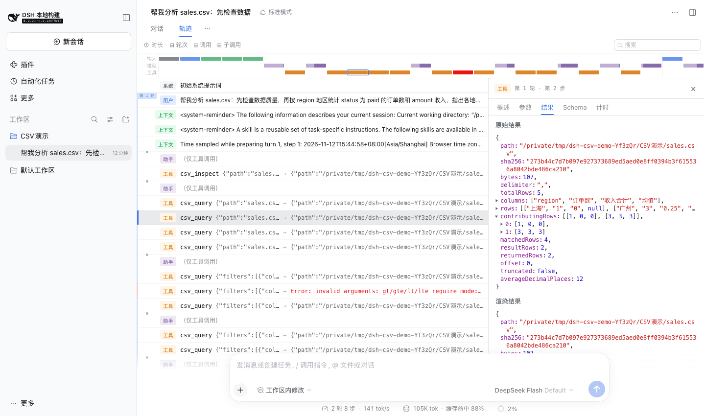

# DSH CSV Analyst

中文 | [English](README.md)

面向 [DeepSeek Harness](https://github.com/deepseek-ai/deepseek-harness) 的只读 CSV 分析插件。销售报表、费用流水、运营导出数据都可以用自然语言提问；模型先发现列名，再调用确定性的工具完成筛选、分组、计算、排序和分页。

与“让模型写一段脚本计算”不同：插件不运行生成的代码，金额求和保留精确的小数与大整数位数，每次结果都区分原始记录、匹配记录、聚合行和本页行数。空金额与错误金额不会悄悄变成零。

## 页面效果

以下截图来自真实 DSH Web 页面，使用内置的合成示例 `sales.csv` 和真实模型，不是效果图。第一张是模型按追问整理的简洁报表，第二张展开了实际分组查询的返回数据。模型文字说明不等于业务审计结论。




## 安装和卸载

本插件基于 **DSH `0.2.2-rc.2`**、**Node `25.6.1`** 开发和测试。这些版本仅用于标注开发基线：插件不声明 engines 限制，不限定宿主 peer 依赖版本，也不在运行时校验版本。其他 DSH 版本可直接尝试使用，不会被插件主动拦截；但这不代表未来所有 API 变化都已验证兼容。全局 `dsh --version` 与源码仓库的 `pnpm dsh --version` 可能不同。

```sh
dsh plugin --profile web add dsh-csv-analyst
dsh web
```

从源码运行时，把命令改成 `pnpm dsh ...`。按需安装到各 profile。npm 包内已带构建产物，没有安装脚本、独立可执行文件或模型替换逻辑；通过标准 `dsh.bundle` 配置注册 `csv_inspect` 和 `csv_query`，不修改客户端 UI。提供 `tools`、`fs`、`workingDirectory` 的 Web、Desktop 和 headless 组合均可加载。

```sh
dsh plugin --profile web remove dsh-csv-analyst
```

插件不创建专属用户文件或设置，卸载后不会留下这些内容；历史会话里的工具结果仍由 DSH 保存。

## 实际使用

把 UTF-8 CSV 放到会话工作目录，告诉 DSH 文件路径；也可以通过附件上传，使用 DSH 分配的可读取文件路径。

- “检查 `sales.csv` 的数据质量，按地区统计已支付订单数和收入，列前十名，并告诉我金额缺失了多少条。”
- “在 `expenses.csv` 中找出金额大于 500 的交易，只返回商户、分类和金额，按金额从高到低排序。”
- “统计 `support.tsv` 各状态的工单数量；这个文件用制表符分隔，不是逗号。”
- “计算 `settlements.csv` 前先检查金额格式，不要猜测货币符号或千位分隔符的含义。”

内置 [examples/sales.csv](examples/sales.csv) 可直接体验。只统计 `status = paid`，按地区求和时，广州收入为 `0.25`、有三条有效金额；上海收入为 `0`、有效金额数为零，但有一条已支付记录且金额为空。结果里的计数会明确说明这一区别。

## 工具与统计口径

`csv_inspect` 返回原始列名、所读取字节的 SHA-256、全文件记录数、每列空值/合法小数/其他值数量，以及有上限的预览。设置 `sample_rows: 0` 可隐藏预览值。列名保留空格且区分大小写。

`csv_query` 支持选列 `select`、同时满足的筛选条件 `filters`、分组 `group_by`、指标 `metrics`、多字段排序 `sort` 及 `offset/limit` 分页。标准返回值采用列名数组和行矩阵，不把 `__proto__` 等外部列名变成 JavaScript 对象属性。Native 工具消息呈现 JSON，PTC 获得相同的类型化字段。

```json
{
  "path": "sales.csv",
  "filters": [{"column": "status", "op": "eq", "value": "paid"}],
  "group_by": ["region"],
  "metrics": [
    {"op": "count", "as": "orders"},
    {"op": "sum", "column": "amount", "as": "revenue"}
  ],
  "sort": [{"column": "revenue", "mode": "decimal", "direction": "desc"}],
  "limit": 10
}
```

- 筛选支持 `eq/ne/contains/empty/not_empty/gt/gte/lt/lte`；`gt/gte/lt/lte` 必须指定 `mode: "decimal"`。默认文本模式区分大小写、不自动裁掉两端空格。空小数单元格不满足任何二元小数条件，包括 `ne`。每个数值筛选都会验证该列所有非空输入，即使同一记录被其他 AND 条件排除，也不隐藏格式错误。
- 指标支持记录数 `count` 和数值 `sum/avg/min/max`。数值允许正负号、十进制点和两端空白；不解释科学计数法、货币符号、千位分隔符、公式、NaN 或 Infinity。数值结果使用**十进制字符串**，不是有精度损失风险的 JSON 浮点数。
- 空数值不参与数值聚合。`contributingRows` 按请求指标的顺序，列出每条返回聚合行各指标真正参与的记录数。空集合的求和为 `"0"`，均值和极值为 `null`。`count` 统计记录而非非空单元格，不接受 `column`。没有匹配记录时，无分组聚合仍返回空统计结果，有分组聚合则返回零组。
- 数字位数在配置限制内时，求和是精确的。均值按 `averageDecimalPlaces` 四舍五入（half-up），默认 12 位小数；不承诺无限循环小数的精确有理数表达。
- `totalRows` 为原始数据记录总数，`matchedRows` 为符合条件的记录数，`resultRows` 为分页前全部输出行数，`returnedRows` 为本页输出行数。`offset` 从零开始。返回页面遗漏任何输出行时，`truncated` 为真。改变 `limit` 不改变统计总量。
- 排序采用字符串码元顺序或精确小数顺序；并列保留输入顺序，升降序均把 null 放最后；小数排序也把空字符串放最后。排序字段必须是输出列名。
- 每次调用都会重新读取全文件。跨页或跨次统计请核对 `sha256`；哈希变化表示数据字节已变化，不提供跨调用的一致快照。插件没有缓存。

## 配置

在 profile 的 `cordis.patch.yml` 中覆盖配置。DSH 替换整行配置，Schemastery 为省略项提供默认值。

```yaml
- id: csv-analyst
  config:
    maxBytes: 8388608
    maxRows: 100000
    maxReturnedRows: 200
    averageDecimalPlaces: 12
```

| 配置项 | 默认值 | 含义 |
| --- | ---: | --- |
| `maxBytes` | 8388608 | 完整文件字节上限，在文件系统读取时执行 |
| `maxRows` | 100000 | 完整数据记录上限 |
| `maxColumns` | 200 | 列数上限 |
| `maxCellChars` | 4096 | 单个表头或单元格的 UTF-16 码元上限 |
| `maxReturnedRows` | 200 | 预览或结果页的行数上限 |
| `defaultPreviewRows` | 5 | 默认预览行数，不超过 `maxReturnedRows`；零表示不预览 |
| `defaultPageRows` | 100 | 默认查询页大小，不超过 `maxReturnedRows` |
| `maxOperations` | 20 | 每个显式选列/筛选/分组/指标/排序列表的项目上限 |
| `maxGroups` | 10000 | 聚合分组数量上限 |
| `maxOutputBytes` | 262144 | 标准返回 JSON 的 UTF-8 字节上限 |
| `maxNumericDigits` | 100 | 单个数值的数字位数上限，含前导零 |
| `averageDecimalPlaces` | 12 | 均值 half-up 四舍五入的小数位数 |
| `batchRows` | 1000 | 分析过程中让出事件循环并检查取消的记录间隔 |

非法配置在加载时报错。超限输入或输出直接失败，不返回部分统计或默默截掉单元格。可以缩小页面、减少选列、拆分文件，或明确提高相关配置限制。

## 安全与限制

这不是 Excel 编辑器、数据库、任意 SQL 引擎或图表生成器。`.xlsx`、旧版 `.xls`、GBK、UTF-16 文件须先导出为 UTF-8 CSV；支持 UTF-8 BOM。插件不猜分隔符：默认逗号，也可明确指定制表符、分号或竖线。表头须非空且唯一；缺列、多列或引用不闭合时报错。跳过物理空行，但保留带引号的单列空值记录；不自动去重。

插件不写文件、不请求网络、不启动进程、不执行动态代码。文件访问走 DSH 的文件系统能力和正常工具权限链，但不会替宿主创建更强的沙箱。表格内容是不可信数据，仍可能带提示词注入。返回的单元格和统计结果会作为正常工具消息发送给模型提供方，并可能保留在 DSH 会话日志里。**只读不等于离线或保密。**

I/O 与分析阶段支持协作取消，卸载会取消并等待正在执行的操作结束。CSV 解析和最后排序是有资源上限的同步操作，定时器触发的取消在它们归还事件循环后才会被观察到，不是硬 CPU 中断。

威胁模型与漏洞报告见 [SECURITY.md](SECURITY.md)。

## 开发和验证

```sh
pnpm install --frozen-lockfile
pnpm check
pnpm audit
```

`check` 包含严格类型检查（不跳过依赖类型声明）、lint、单元/属性/真实运行时测试、源码 100% 覆盖率门槛、ESM 与声明构建、npm 文件白名单检查，并禁止安装脚本、直接宿主文件系统访问及动态代码执行。运行时测试使用真实 Cordis、Native 执行器、本地文件系统与工作目录服务，不需要模型密钥。

用户可见结果快照位于 [tests/snapshots](tests/snapshots)，CI 覆盖 Linux/macOS/Windows。本机验证通过不能代替远端 CI，也不能证明不存在任何漏洞或支持所有 DSH 版本。实际发布验证及剩余限制见 [docs/verification.md](docs/verification.md)。
